# ShopEasy: Full-Stack E-Commerce App

ShopEasy is a full-stack online shop. Customers can browse products, manage a cart with delivery options, pay with Stripe (test mode), track their orders and download PDF invoices. Administrators can add, edit and delete products with image uploads. Changes appear live in every open browser tab thanks to WebSockets.

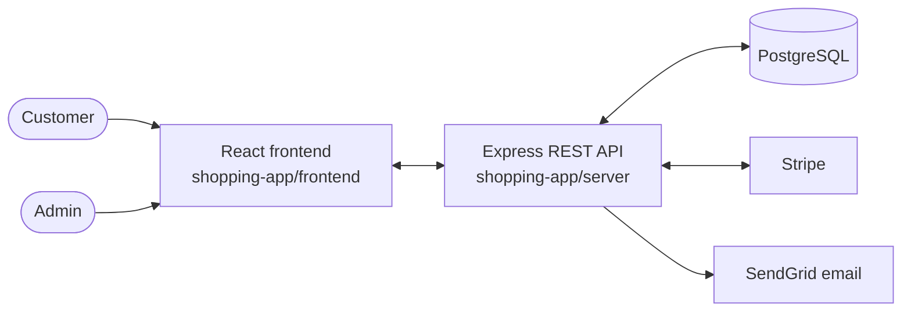

---

## Table of contents

1. [Features](#features)
2. [Tech stack](#tech-stack)
3. [Software architecture](#software-architecture)
4. [Project structure](#project-structure)
5. [Getting started (step by step)](#getting-started-step-by-step)
6. [Using the app for the first time](#using-the-app-for-the-first-time)
7. [Payments with Stripe (test mode)](#payments-with-stripe-test-mode)
8. [Environment variables](#environment-variables)
9. [Available scripts](#available-scripts)
10. [API reference](#api-reference)
11. [Database schema](#database-schema)
12. [Known limitations](#known-limitations)

---

## Features

### For customers

- **Product catalogue** with pagination (50 products per page) and instant search by title
- **Product details** page
- **Cart**: add products (quantity 1 to 10), remove them, and choose a delivery option per item:

  | Option | Delivery time | Price |
  |---|---|---|
  | Standard | 7 days | Free |
  | Express | 3 days | RM 4.99 |
  | Next day | 1 day | RM 9.99 |

- **Checkout with Stripe**: items, shipping and 10% tax on a Stripe Checkout page (currency: MYR)
- **Orders page**: continue or cancel a pending payment, remove expired payments, mark paid orders as received
- **Package tracking** with a progress bar (Preparing → Shipped → Delivered)
- **PDF invoice** for every paid order
- **Accounts**: sign up, log in, log out, reset a forgotten password by email

### For administrators

- **Admin sign-up** with a secret invitation code (`ADMIN_PASSKEY`)
- **Product management**: add, edit and delete products (PNG/JPG images up to 5 MB, price RM 1 to RM 99,999)
- Products that appear in any order can't be deleted, so order history and invoices stay complete

### Real-time and security

- Live updates with **Socket.IO** (cart count, logout across tabs, admin product list)
- **bcrypt** password hashing, **sessions stored in PostgreSQL**, a new session ID on every login
- **CSRF token** on every request that changes data, **server-side validation**, **Helmet** headers, **CORS** limited to the frontend
- Password-reset tokens stored only as a SHA-256 hash (valid 1 hour); Stripe webhooks verified by signature

---

## Tech stack

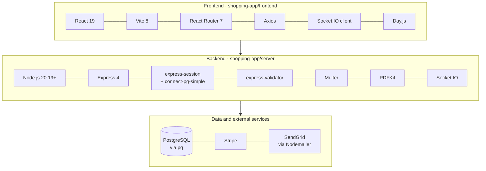

### Frontend (`shopping-app/frontend`)

| Technology | Version | Used for |
|---|---|---|
| [React](https://react.dev) | 19 | User interface (components, hooks) |
| [Vite](https://vite.dev) | 8 | Development server and production build |
| [React Router](https://reactrouter.com) (`react-router-dom`) | 7 | Page routing in the browser |
| [Axios](https://axios-http.com) | 1 | HTTP requests to the API (adds the CSRF token, retries once if it's stale) |
| [Socket.IO client](https://socket.io) | 4 | Real-time events from the server |
| [Day.js](https://day.js.org) | 1 | Date formatting (delivery dates) |
| [ESLint](https://eslint.org) | 10 | Code linting |

### Backend (`shopping-app/server`)

| Technology | Version | Used for |
|---|---|---|
| [Node.js](https://nodejs.org) | 20.19+ | JavaScript runtime |
| [Express](https://expressjs.com) | 4 | HTTP server, routing and middleware |
| [PostgreSQL](https://www.postgresql.org) + [`pg`](https://node-postgres.com) | 8 (driver) | Database, accessed with plain SQL (no ORM) |
| [express-session](https://github.com/expressjs/session) + [connect-pg-simple](https://github.com/voxpelli/node-connect-pg-simple) | 1 / 10 | Login sessions, stored in a PostgreSQL `session` table |
| [express-validator](https://express-validator.github.io) | 7 | Validating and sanitising request data |
| [bcrypt](https://github.com/kelektiv/node.bcrypt.js) | 6 | Password hashing |
| [Helmet](https://helmetjs.github.io) / [cors](https://github.com/expressjs/cors) | 8 / 2 | Security headers / cross-origin access for the frontend |
| [Multer](https://github.com/expressjs/multer) | 2 | Product image uploads |
| [Stripe](https://stripe.com/docs/api) | 22 | Checkout Sessions and payment webhooks |
| [PDFKit](https://pdfkit.org) | 0.19 | Invoice PDFs |
| [Socket.IO](https://socket.io) | 4 | Real-time events (shares the login session) |
| [Nodemailer](https://nodemailer.com) + SendGrid | 9 | Sign-up and password-reset emails |
| [dotenv](https://github.com/motdotla/dotenv) | 17 | Loading settings from `.env` |
| [nodemon](https://nodemon.io) | 1 | Restarting the server on file changes (development) |

---

## Software architecture

### System overview

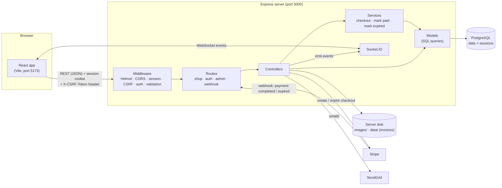

### Backend: how a request is processed

Every request passes through a chain of middleware before reaching a controller. Each check can stop the request with an error response:

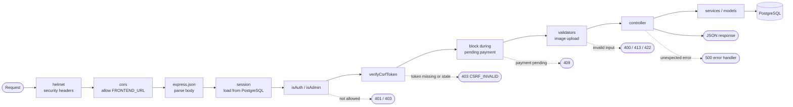

Not every route uses every check: for example, product pages need no login, and only admin routes use `isAdmin`. The Stripe webhook (`POST /stripe-webhook`) is registered before `express.json`, because Stripe's signature check needs the raw request body.

| Layer | Folder | Responsibility |
|---|---|---|
| **Routes** | `routes/` | Map URLs to handlers and chain the middleware |
| **Middleware** | `middleware/` | Reusable checks: logged in, admin, CSRF token, cart/product locked during a pending payment |
| **Controllers** | `controllers/` | Read the request, call models and services, send the JSON response |
| **Services** | `services/` | Multi-step business logic in database transactions (create pending order, mark paid / expired) |
| **Models** | `model/` | SQL queries for products, carts and orders |
| **Utilities** | `util/` | Database pool, Stripe client, upload/invoice folders, pagination, file deletion |

### Frontend structure

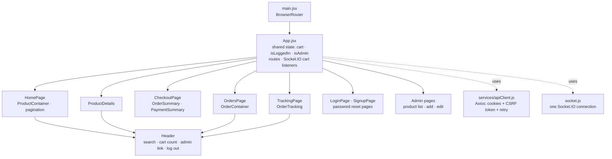

`App.jsx` owns the state that several pages need (cart, login status, admin role) and passes it down as props. All pages use the same Axios instance (`apiClient`) and the same Socket.IO connection.

### Example: adding a product to the cart

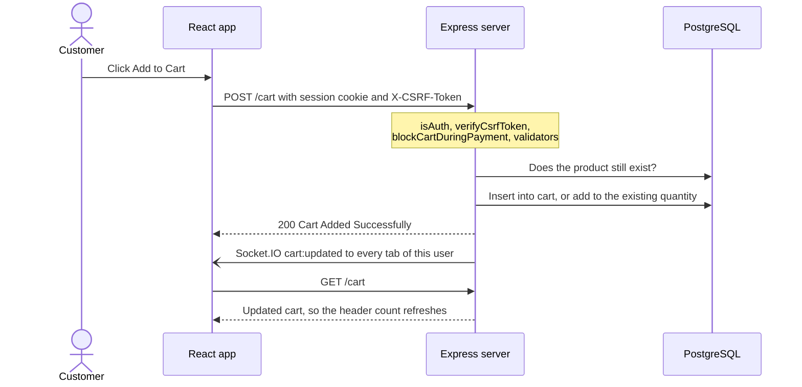

### Checkout and payment

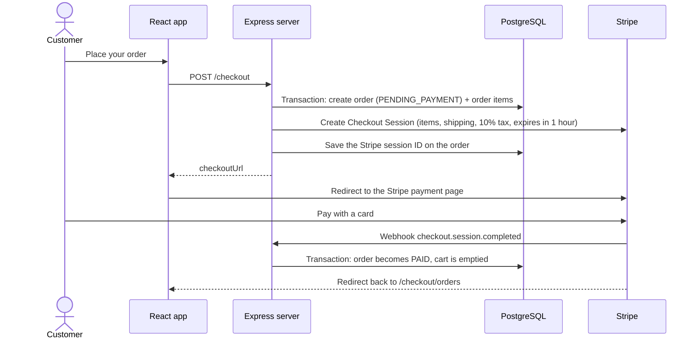

### Order status lifecycle

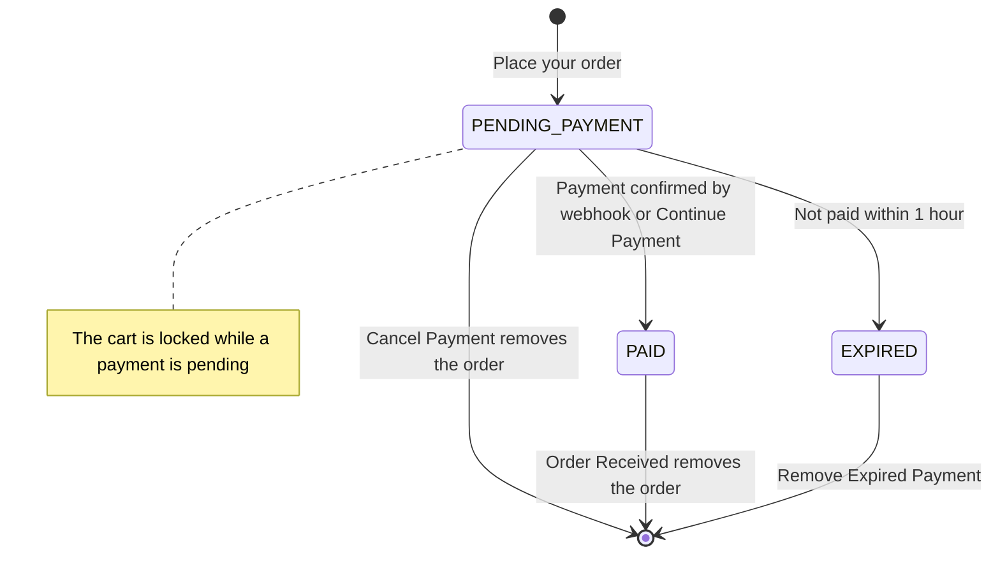

### Sessions and CSRF protection

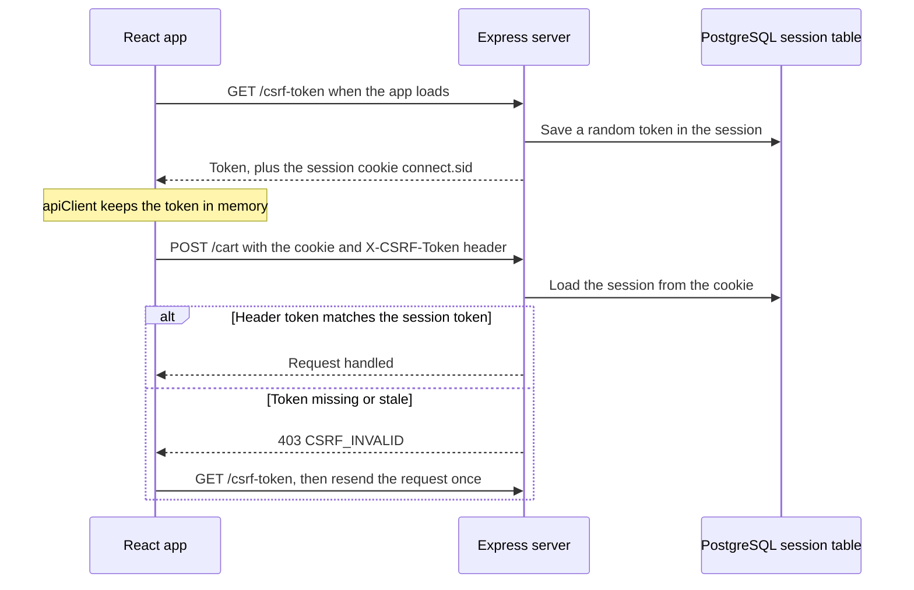

On login, the server replaces the session with a new one (new session ID), and the frontend fetches a new token. Another website can make the browser send the cookie, but it can't read the token, so its requests fail the check.

### Real-time updates (Socket.IO)

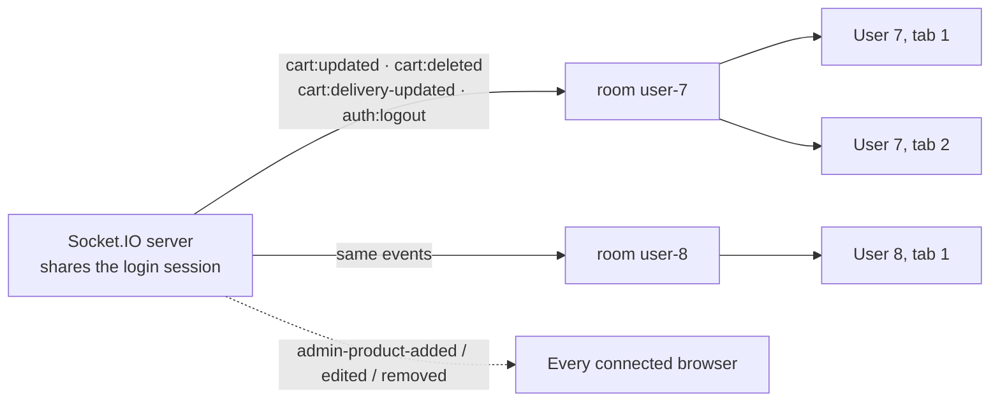

When a socket connects, the server reads the session to find the user and puts the socket in that user's room. Events for one user reach all of that user's tabs; catalogue changes reach everyone.

### Password reset

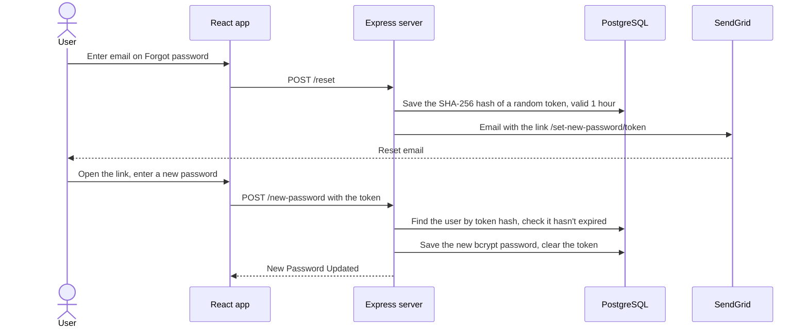

### Deleting a product (admin)

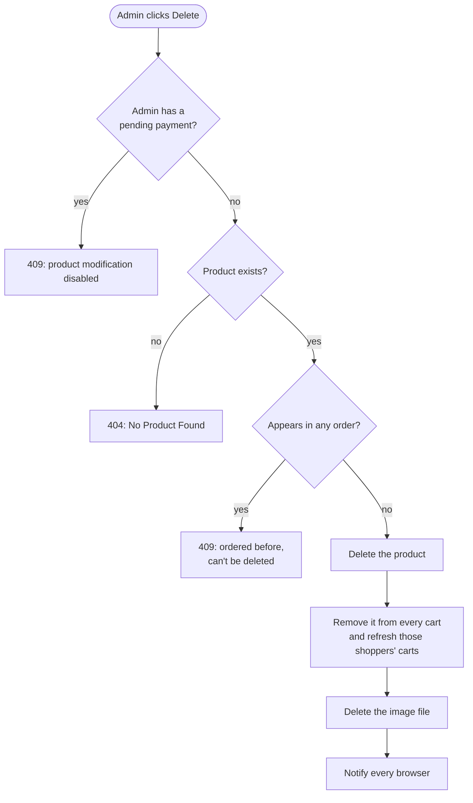

---

## Project structure

```
shopeasy-pern-ecommerce/
├── README.md
└── shopping-app/
    ├── frontend/                     React app (Vite)
    │   ├── .env                      VITE_API_URL: address of the API
    │   ├── index.html
    │   ├── vite.config.js            Dev server on port 5173
    │   ├── public/images/            Logos, icons, rating stars
    │   └── src/
    │       ├── main.jsx              Entry point (BrowserRouter)
    │       ├── App.jsx               Routes + shared state (cart, login, admin)
    │       ├── socket.js             Socket.IO connection
    │       ├── services/apiClient.js Axios instance + CSRF handling
    │       ├── components/Header.jsx
    │       ├── utils/                Money formatting, cart quantity
    │       └── pages/
    │           ├── home/             Product list, details, pagination
    │           ├── checkout/         Cart, delivery options, payment summary
    │           ├── order/            Orders, continue/cancel payment, invoices
    │           ├── tracking/         Package tracking
    │           ├── auth/             Log in, sign up, password reset
    │           ├── admin/            Product list, add and edit forms
    │           └── error404/
    └── server/                       REST API (Express)
        ├── app.js                    Server setup: middleware, sessions, routes, Socket.IO
        ├── schema.sql                Database tables + delivery options
        ├── .env.example              Template for the server's settings
        ├── routes/                   shop.js · auth.js · admin.js
        ├── controllers/              shop.js · auth.js · admin.js · error.js
        ├── middleware/               isAuth · isAdmin · verifyCsrfToken · blockCartDuringPayment · blockProductDuringPayement
        ├── services/                 checkoutService · markOrderPaid · markOrderExpired
        ├── model/                    product.js · cart.js · orders.js
        ├── util/                     database · stripe-payment · folders · file · pagination
        ├── images/                   Uploaded product images (created automatically, not in git)
        └── data/                     Generated invoice PDFs (created automatically, not in git)
```

---

## Getting started (step by step)

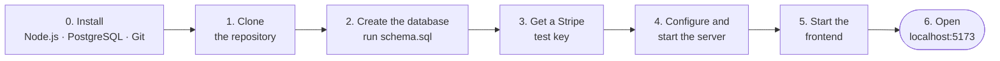

### Step 0: Install the requirements

| Tool | Version | Notes |
|---|---|---|
| **Node.js** | **20.19 or newer** (22 LTS recommended) | Includes `npm`. Check with `node -v` |
| **PostgreSQL** | Any recent version (developed with 15) | Remember the username and password you choose during installation |
| **Git** | Any | To clone the repository |
| **Stripe account** | Free | **Required**: the server won't start without a Stripe secret key. Test mode is enough, and no real money is involved |
| Stripe CLI | Optional | Only needed to confirm payments locally (see [Payments](#payments-with-stripe-test-mode)) |
| SendGrid account | Optional | Only needed for sign-up and password-reset emails |

### Step 1: Clone the repository

```bash
git clone https://github.com/jlau050426/shopeasy-pern-ecommerce.git
cd shopeasy-pern-ecommerce/shopping-app
```

All the following commands start from this `shopping-app` folder.

### Step 2: Create the database

Create an empty database (here called `shopping_app`):

```bash
psql -U postgres -c "CREATE DATABASE shopping_app;"
```

Create the tables and the delivery options:

```bash
psql -U postgres -d shopping_app -f server/schema.sql
```

You should see `CREATE TABLE` six times and `INSERT 0 3`. Replace `postgres` with your PostgreSQL username if it's different. The `session` table for logins is created automatically when the server starts.

> **Windows:** `psql` is often not on the PATH. Use its full path, for example
> `"C:\Program Files\PostgreSQL\15\bin\psql.exe" -U postgres -c "CREATE DATABASE shopping_app;"`,
> or use **pgAdmin**: create the database, open `server/schema.sql` in the **Query Tool**, and run it.

### Step 3: Get your Stripe test key

Sign in at [dashboard.stripe.com](https://dashboard.stripe.com), make sure **Test mode** is on, then go to **Developers → API keys** and copy the **Secret key** (it starts with `sk_test_`).

### Step 4: Configure and start the server

Create the server's `.env` file from the template (Windows Command Prompt: `copy .env.example .env`):

```bash
cd server
cp .env.example .env
```

Open `server/.env` and fill in your values:

| Setting | What to enter |
|---|---|
| `DATABASE_USER`, `DATABASE_PASSWORD` | Your PostgreSQL username and password |
| `DATABASE_NAME` | `shopping_app` (or the name you used in Step 2) |
| `SESSION_SECRET` | Any long random text (see the command below) |
| `ADMIN_PASSKEY` | A code of your choice. You'll type it on the sign-up page to create an admin |
| `STRIPE_SECRET_KEY` | The `sk_test_...` key from Step 3 |
| `STRIPE_WEBHOOK_SECRET` | Leave as is for now (see [Payments](#payments-with-stripe-test-mode)) |
| `SENDGRID_API_KEY`, `EMAIL_FROM` | Optional, for emails |

To generate a random `SESSION_SECRET`:

```bash
node -e "console.log(require('crypto').randomBytes(32).toString('hex'))"
```

Keep `PORT=3000` and `FRONTEND_URL=http://localhost:5173` unless you need different ports. If you change `PORT`, also change `VITE_API_URL` in `frontend/.env` to match.

Install the dependencies and start the server:

```bash
npm install
npm run dev
```

You should see `Server listen on PORT 3000`. Keep this terminal open.

### Step 5: Start the frontend

Open a **second terminal** in the `shopping-app` folder:

```bash
cd frontend
npm install
npm run dev
```

The frontend already contains `frontend/.env` with `VITE_API_URL=http://localhost:3000`, so it finds the server automatically.

### Step 6: Open the shop

Go to **http://localhost:5173**. When everything runs, your setup looks like this:

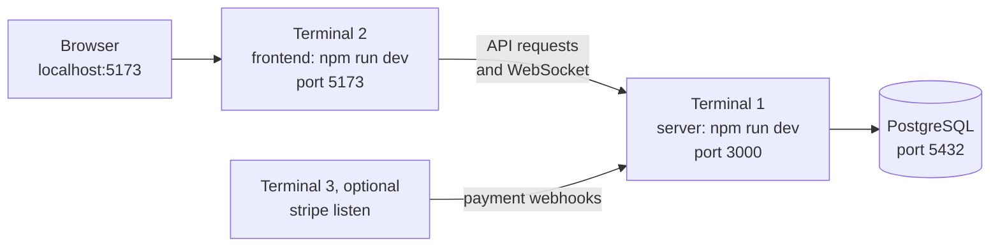

The shop is empty at first. Continue with the next section to add products.

---

## Using the app for the first time

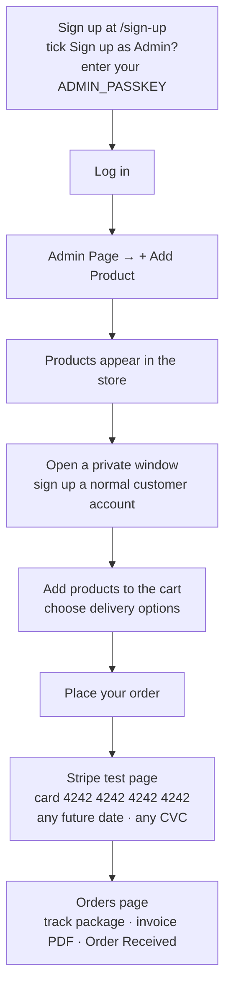

| Field | Rule |
|---|---|
| Password | At least 6 characters, letters and numbers only |
| Product title | At least 3 characters |
| Product image | PNG or JPG, up to 5 MB |
| Product price | RM 1 to RM 99,999 |
| Product description | At least 6 characters |

---

## Payments with Stripe (test mode)

After a payment, Stripe tells your server about it through a **webhook**. On your own computer, Stripe can't reach `localhost` directly, so the **Stripe CLI** forwards the events for you:

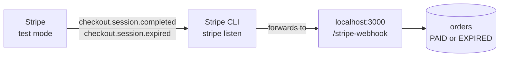

1. Install the Stripe CLI: [stripe.com/docs/stripe-cli](https://stripe.com/docs/stripe-cli)
2. Log in once:

   ```bash
   stripe login
   ```

3. Forward webhook events to your server (keep this running in a third terminal):

   ```bash
   stripe listen --forward-to localhost:3000/stripe-webhook
   ```

4. It prints a signing secret starting with `whsec_`. Put it in `server/.env` as `STRIPE_WEBHOOK_SECRET`, then restart the server.

**Without the Stripe CLI**, payments still work, but orders stay **Pending Payment** after paying. Click **CONTINUE PAYMENT** on the Orders page: the server then asks Stripe directly and marks the order as paid.

| Test card number | Result |
|---|---|
| `4242 4242 4242 4242` | Payment succeeds |
| `4000 0000 0000 9995` | Payment is declined (insufficient funds) |

---

## Environment variables

### Server: `shopping-app/server/.env`

| Variable | Required | Example | Description |
|---|---|---|---|
| `PORT` | No (default `5000`) | `3000` | Port of the API server. Must match `VITE_API_URL` in the frontend |
| `FRONTEND_URL` | **Yes** | `http://localhost:5173` | Address of the React app. Used for CORS, Socket.IO, Stripe redirects and email links |
| `DATABASE_HOST` | **Yes** | `localhost` | PostgreSQL host |
| `DATABASE_PORT` | **Yes** | `5432` | PostgreSQL port |
| `DATABASE_USER` | **Yes** | `postgres` | PostgreSQL username |
| `DATABASE_PASSWORD` | **Yes** | | PostgreSQL password |
| `DATABASE_NAME` | **Yes** | `shopping_app` | Database created in Step 2 |
| `SESSION_SECRET` | **Yes** | random text | Signs the session cookie. Without it, every request fails |
| `ADMIN_PASSKEY` | **Yes** (for admins) | | Code required to sign up as an admin |
| `STRIPE_SECRET_KEY` | **Yes** | `sk_test_...` | Stripe secret key. Without it, the server doesn't start |
| `STRIPE_WEBHOOK_SECRET` | For webhooks | `whsec_...` | From `stripe listen` or the Stripe Dashboard |
| `SENDGRID_API_KEY` | For emails | `SG....` | SendGrid API key |
| `EMAIL_FROM` | For emails | `you@example.com` | Sender address. Must be a verified sender in your SendGrid account |

### Frontend: `shopping-app/frontend/.env`

| Variable | Default | Description |
|---|---|---|
| `VITE_API_URL` | `http://localhost:3000` | Address of the API server. Used for requests, Socket.IO and images |

> Never commit `server/.env`: it contains your real keys. It's already listed in `.gitignore`.

---

## Available scripts

| Folder | Command | Description |
|---|---|---|
| `server` | `npm run dev` | Start the server with nodemon (restarts on file changes) |
| `server` | `npm start` | Start the server with Node (no automatic restart) |
| `frontend` | `npm run dev` | Start the Vite development server on port 5173 |
| `frontend` | `npm run build` | Build the production version into `dist/` |
| `frontend` | `npm run preview` | Preview the production build locally |
| `frontend` | `npm run lint` | Check the code with ESLint |

---

## API reference

All endpoints are relative to `http://localhost:3000`. Requests that change data (`POST`, `PUT`, `DELETE`) need the `X-CSRF-Token` header (see [Sessions and CSRF protection](#sessions-and-csrf-protection)). 🔒 = must be logged in, 👑 = must be an admin.

### Products and cart

| Method | Endpoint | Description |
|---|---|---|
| `GET` | `/?page=1` | Products for a page (50 per page) |
| `GET` | `/product/:productID` | One product |
| `GET` | `/delivery-options` | The three delivery options |
| `GET` | `/cart` 🔒 | The user's cart, item total and shipping total |
| `POST` | `/cart` 🔒 | Add a product: `{ productId, quantity }` (quantity 1 to 10) |
| `PUT` | `/cart-items/:id` 🔒 | Change a cart item's delivery option: `{ deliveryOptionId }` |
| `DELETE` | `/cart-delete-item/:id` 🔒 | Remove a cart item |

### Checkout and orders

| Method | Endpoint | Description |
|---|---|---|
| `POST` | `/checkout` 🔒 | Create a pending order and a Stripe Checkout Session; returns `checkoutUrl` |
| `POST` | `/checkout/continue` 🔒 | Resume the pending payment (or mark it paid if Stripe already completed it) |
| `GET` | `/pending-payment` 🔒 | `200` if a payment is pending, `204` if not |
| `GET` | `/checkout/orders` 🔒 | The user's orders, grouped with their items |
| `GET` | `/checkout/order-&-product?orderID=&productID=` 🔒 | One item of one order (for tracking) |
| `GET` | `/order/:orderID` 🔒 | Download the invoice PDF (paid orders only) |
| `DELETE` | `/orders/:orderId` 🔒 | Mark a paid order as received (removes it) |
| `DELETE` | `/remove-payment/:orderId` 🔒 | Cancel a pending payment |
| `DELETE` | `/remove-expired/:orderId` 🔒 | Remove an expired order |
| `POST` | `/stripe-webhook` | Stripe webhook (raw body, verified by signature) |

### Authentication

| Method | Endpoint | Description |
|---|---|---|
| `GET` | `/csrf-token` | Get the CSRF token for the current session |
| `POST` | `/sign-up` | `{ email, password, confirmPassword, adminInvitationCode? }` |
| `POST` | `/login` | `{ email, password }`; starts a new session |
| `POST` | `/logout` | Ends the session |
| `POST` | `/reset` | `{ email }`; emails a password-reset link |
| `POST` | `/new-password` | `{ token, newPassword, confirmPassword }` |
| `GET` | `/check-admin` | `200` for admins, `403` for normal users, `401` for guests |

### Admin (prefix `/admin`)

| Method | Endpoint | Description |
|---|---|---|
| `GET` | `/admin/admin-page` 👑 | Checks admin access for the product list page |
| `GET` | `/admin/add-product` 👑 | Checks admin access for the add form |
| `POST` | `/admin/add-product` 👑 | Add a product (`multipart/form-data`: `title`, `price`, `description`, `image`) |
| `GET` | `/admin/edit-product/:productID` 👑 | Current values of a product, for the edit form |
| `POST` | `/admin/edit-product` 👑 | Update a product (`id`, `title`, `price`, `description`, optional `image`) |
| `DELETE` | `/admin/delete-product/:productID` 👑 | Delete a product (refused if it appears in any order) |

### Socket.IO events (server → browser)

| Event | Sent to | When |
|---|---|---|
| `cart:updated` | That user's tabs | A product was added to the cart (or removed by an admin) |
| `cart:deleted` | That user's tabs | A cart item was removed |
| `cart:delivery-updated` | That user's tabs | A delivery option changed |
| `auth:logout` | That user's tabs | The user logged out |
| `admin-product-added` / `-edited` / `-removed` | Everyone | An admin changed the catalogue |

---

## Database schema

The tables are created by `server/schema.sql`. The `session` table is created automatically by `connect-pg-simple`.

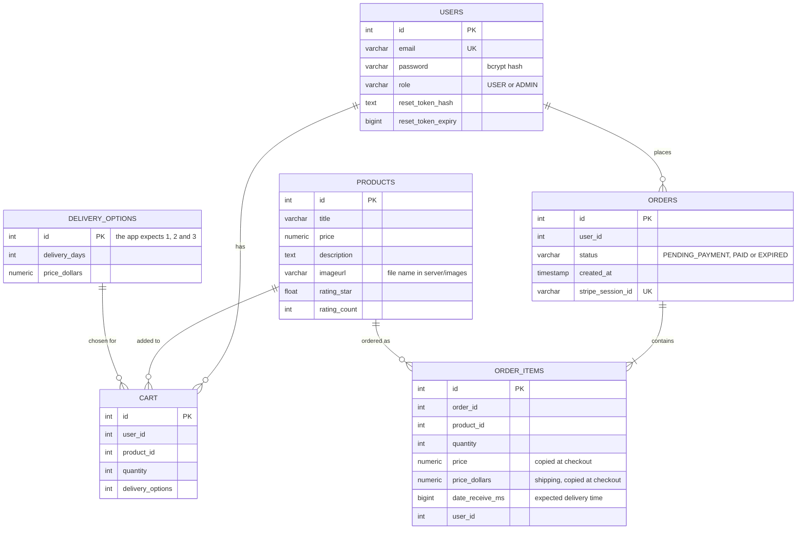

- The relationships are enforced by the application code (the tables have no foreign keys).
- `cart` allows one row per user and product (`UNIQUE (user_id, product_id)`); adding the same product again increases the quantity.
- Prices and shipping costs are copied into `order_items` at checkout, so editing a product later doesn't change past orders.

---

## Known limitations

- **Totals may differ by RM 0.01.** The cart page, the Orders page and Stripe round the 10% tax in slightly different ways, so a total can occasionally differ by one sen. The amount shown on Stripe's payment page is the amount charged. The cart page shows a note about this.
- **Images are stored on the server's disk** (`server/images`), not in git or the database. A fresh copy of the project starts without product images, and some hosting providers delete local files on every deploy.
- **Rating stars** are display-only. There's no way to rate products yet, so products added through the admin form show empty stars.
- **No automated tests** yet.
- Built and tested for **local development**. Deploying to production needs extra settings (HTTPS-only cookies, proxy settings, production URLs and a Stripe webhook endpoint).
