# ShopEasy：全栈电子商务应用

[English](README.md) | 简体中文

ShopEasy 是一个全栈网上商店。顾客可以浏览商品、管理购物车并选择配送方式、通过 Stripe（测试模式）付款、追踪订单并下载 PDF 发票。管理员可以新增、编辑和删除商品，并上传商品图片。借助 WebSocket，所有更改都会实时显示在每个打开的浏览器标签页中。

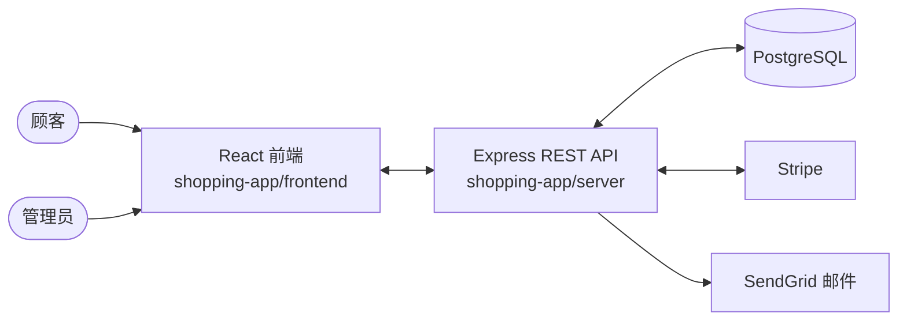

---

## 目录

1. [功能特性](#功能特性)
2. [技术栈](#技术栈)
3. [软件架构](#软件架构)
4. [项目结构](#项目结构)
5. [快速开始](#快速开始)
6. [首次使用](#首次使用)
7. [使用 Stripe 付款](#使用-stripe-付款)
8. [环境变量](#环境变量)
9. [可用脚本](#可用脚本)
10. [API 参考](#api-参考)
11. [数据库结构](#数据库结构)
12. [已知限制](#已知限制)

---

## 功能特性

### 顾客功能

- **商品目录**：分页显示（每页 50 件商品），并可按标题即时搜索
- **商品详情**页面
- **购物车**：加入商品（数量 1 至 10）、移除商品，并为每件商品选择配送方式：

  | 配送方式 | 配送时间 | 价格 |
  |---|---|---|
  | 标准 | 7 天 | 免费 |
  | 快递 | 3 天 | RM 4.99 |
  | 次日达 | 1 天 | RM 9.99 |

- **Stripe 结账**：在 Stripe 结账页面支付商品、运费和 10% 税费（货币：MYR）
- **订单页面**：继续或取消待付款订单、移除已过期的付款、将已付款订单标记为已收货
- **包裹追踪**：显示进度条（备货中 → 已发货 → 已送达）
- **PDF 发票**：每笔已付款订单都可下载
- **账户**：注册、登录、登出，以及通过电子邮件重设忘记的密码

### 管理员功能

- **管理员注册**：需要输入秘密邀请码（`ADMIN_PASSKEY`）
- **商品管理**：新增、编辑和删除商品（PNG/JPG 图片，最大 5 MB；价格 RM 1 至 RM 99,999）
- 曾出现在任何订单中的商品无法删除，以确保订单记录和发票完整

### 实时更新与安全

- 使用 **Socket.IO** 实时更新（购物车数量、跨标签页登出、管理员商品列表）
- **bcrypt** 密码哈希、**会话存储在 PostgreSQL 中**、每次登录都会生成新的会话 ID
- 所有修改数据的请求都需要 **CSRF 令牌**，并有**服务器端验证**、**Helmet** 安全标头，以及只允许前端访问的 **CORS**
- 重设密码令牌只以 SHA-256 哈希形式保存（有效期 1 小时）；Stripe webhook 通过签名验证

---

## 技术栈

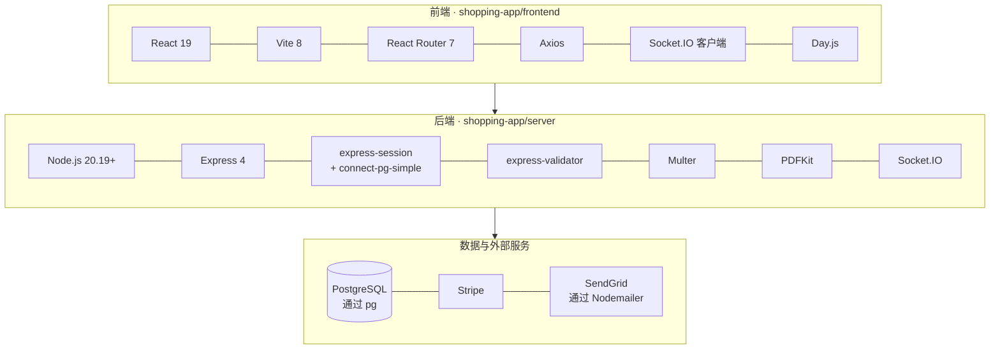

### 前端（`shopping-app/frontend`）

| 技术 | 版本 | 用途 |
|---|---|---|
| [React](https://react.dev) | 19 | 用户界面（组件、Hooks） |
| [Vite](https://vite.dev) | 8 | 开发服务器与生产构建 |
| [React Router](https://reactrouter.com)（`react-router-dom`） | 7 | 浏览器端页面路由 |
| [Axios](https://axios-http.com) | 1 | 向 API 发送 HTTP 请求（自动附加 CSRF 令牌，令牌失效时自动重试一次） |
| [Socket.IO 客户端](https://socket.io) | 4 | 接收服务器的实时事件 |
| [Day.js](https://day.js.org) | 1 | 日期格式化（配送日期） |
| [ESLint](https://eslint.org) | 10 | 代码检查 |

### 后端（`shopping-app/server`）

| 技术 | 版本 | 用途 |
|---|---|---|
| [Node.js](https://nodejs.org) | 20.19+ | JavaScript 运行环境 |
| [Express](https://expressjs.com) | 4 | HTTP 服务器、路由与中间件 |
| [PostgreSQL](https://www.postgresql.org) + [`pg`](https://node-postgres.com) | 8（驱动） | 数据库，直接使用 SQL 访问（不使用 ORM） |
| [express-session](https://github.com/expressjs/session) + [connect-pg-simple](https://github.com/voxpelli/node-connect-pg-simple) | 1 / 10 | 登录会话，存储在 PostgreSQL 的 `session` 表中 |
| [express-validator](https://express-validator.github.io) | 7 | 验证与清理请求数据 |
| [bcrypt](https://github.com/kelektiv/node.bcrypt.js) | 6 | 密码哈希 |
| [Helmet](https://helmetjs.github.io) / [cors](https://github.com/expressjs/cors) | 8 / 2 | 安全标头 / 允许前端跨域访问 |
| [Multer](https://github.com/expressjs/multer) | 2 | 商品图片上传 |
| [Stripe](https://stripe.com/docs/api) | 22 | 结账会话（Checkout Session）与付款 webhook |
| [PDFKit](https://pdfkit.org) | 0.19 | 生成 PDF 发票 |
| [Socket.IO](https://socket.io) | 4 | 实时事件（与登录会话共享） |
| [Nodemailer](https://nodemailer.com) + SendGrid | 9 | 注册与重设密码邮件 |
| [dotenv](https://github.com/motdotla/dotenv) | 17 | 从 `.env` 载入设置 |
| [nodemon](https://nodemon.io) | 1 | 文件更改时自动重启服务器（开发用） |

---

## 软件架构

### 系统总览

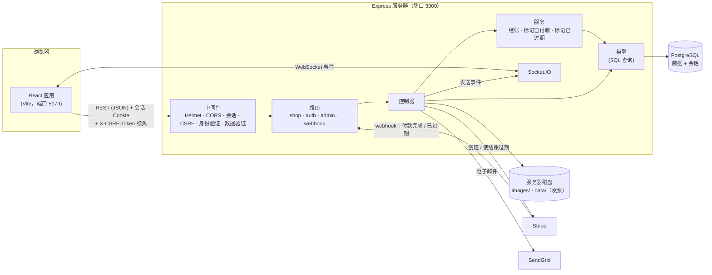

### 后端：请求如何被处理

每个请求在到达控制器之前，都会经过一连串中间件。任何一项检查都可以用错误响应终止请求：

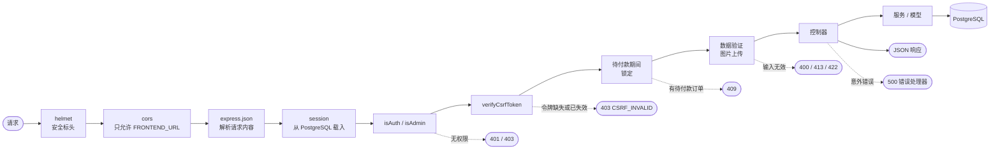

并非每条路由都使用所有检查：例如商品页面不需要登录，只有管理员路由才使用 `isAdmin`。Stripe webhook（`POST /stripe-webhook`）在 `express.json` 之前注册，因为 Stripe 的签名验证需要原始请求内容。

| 层级 | 文件夹 | 职责 |
|---|---|---|
| **路由** | `routes/` | 将 URL 对应到处理函数，并串联中间件 |
| **中间件** | `middleware/` | 可重复使用的检查：已登录、管理员、CSRF 令牌、待付款期间锁定购物车/商品 |
| **控制器** | `controllers/` | 读取请求、调用模型与服务、返回 JSON 响应 |
| **服务** | `services/` | 在数据库事务中执行的多步骤业务逻辑（创建待付款订单、标记已付款 / 已过期） |
| **模型** | `model/` | 商品、购物车和订单的 SQL 查询 |
| **工具** | `util/` | 数据库连接池、Stripe 客户端、上传/发票文件夹、分页、删除文件 |

### 前端结构

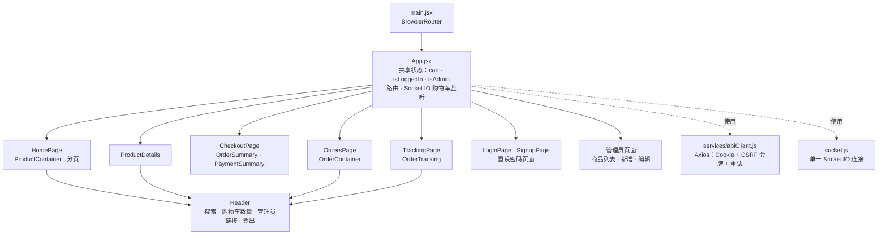

`App.jsx` 管理多个页面都需要的状态（购物车、登录状态、管理员身份），并通过 props 传递下去。所有页面都使用同一个 Axios 实例（`apiClient`）和同一个 Socket.IO 连接。

### 示例：将商品加入购物车

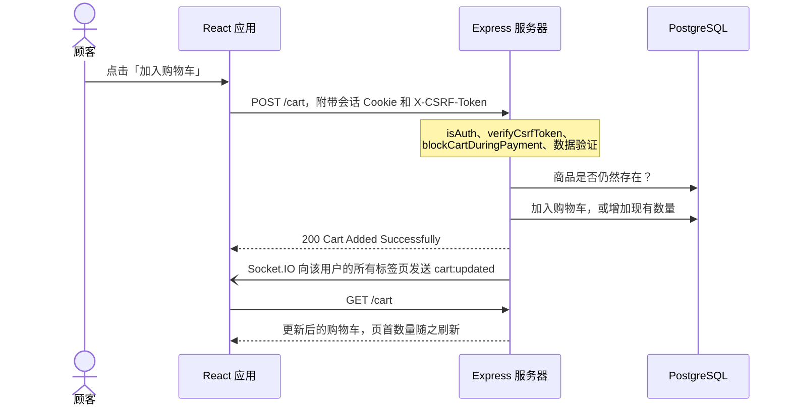

### 结账与付款

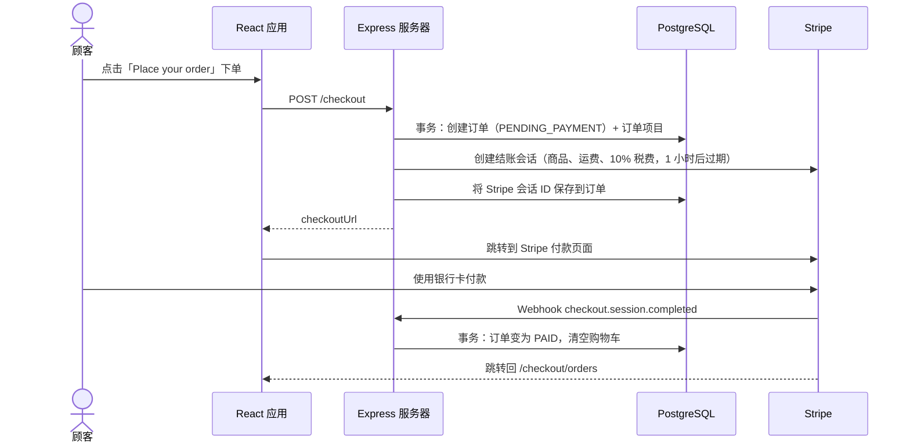

### 订单状态流程

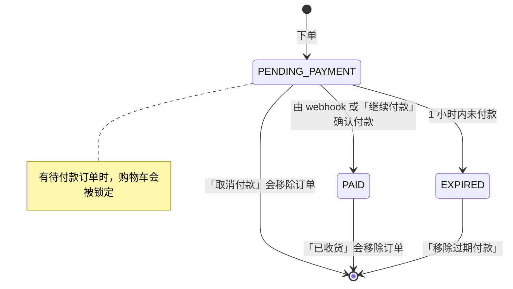

### 会话与 CSRF 防护

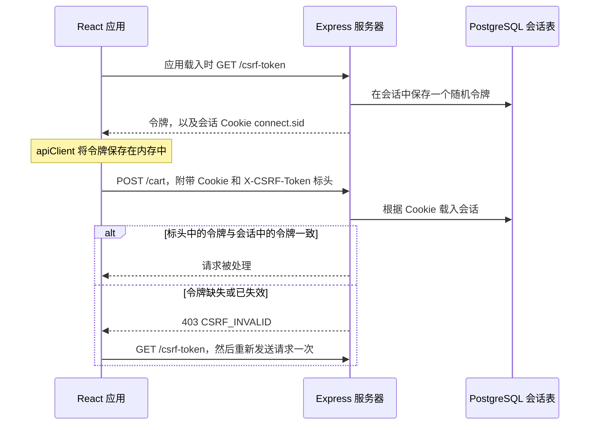

登录时，服务器会用新的会话替换旧会话（新的会话 ID），前端也会获取新的令牌。其他网站可以让浏览器附带 Cookie，但无法读取令牌，因此它们的请求无法通过检查。

### 实时更新（Socket.IO）

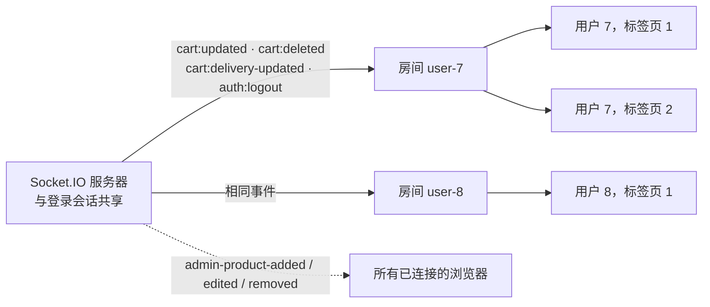

Socket 连接时，服务器会读取会话来识别用户，并把该连接加入这个用户的房间。发给某个用户的事件会送达他所有的标签页；商品目录的更改则会发送给所有人。

### 重设密码

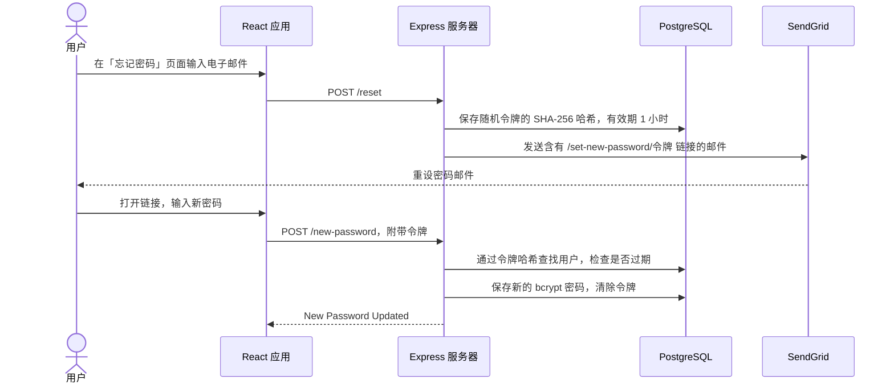

### 删除商品（管理员）

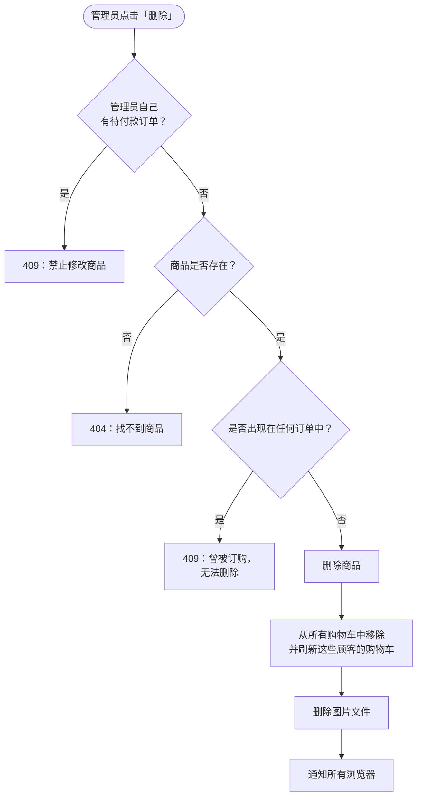

---

## 项目结构

```
shopeasy-pern-ecommerce/
├── README.md                     英文说明文档
├── README.zh-CN.md               中文说明文档
└── shopping-app/
    ├── frontend/                     React 应用（Vite）
    │   ├── .env                      VITE_API_URL：API 地址
    │   ├── index.html
    │   ├── vite.config.js            开发服务器端口 5173
    │   ├── public/images/            标志、图标、评分星星
    │   └── src/
    │       ├── main.jsx              入口（BrowserRouter）
    │       ├── App.jsx               路由 + 共享状态（购物车、登录、管理员）
    │       ├── socket.js             Socket.IO 连接
    │       ├── services/apiClient.js Axios 实例 + CSRF 处理
    │       ├── components/Header.jsx
    │       ├── utils/                金额格式化、购物车数量
    │       └── pages/
    │           ├── home/             商品列表、详情、分页
    │           ├── checkout/         购物车、配送方式、付款摘要
    │           ├── order/            订单、继续/取消付款、发票
    │           ├── tracking/         包裹追踪
    │           ├── auth/             登录、注册、重设密码
    │           ├── admin/            商品列表、新增与编辑表单
    │           └── error404/
    └── server/                       REST API（Express）
        ├── app.js                    服务器设置：中间件、会话、路由、Socket.IO
        ├── schema.sql                数据库表 + 配送方式
        ├── .env.example              服务器设置模板
        ├── routes/                   shop.js · auth.js · admin.js
        ├── controllers/              shop.js · auth.js · admin.js · error.js
        ├── middleware/               isAuth · isAdmin · verifyCsrfToken · blockCartDuringPayment · blockProductDuringPayement
        ├── services/                 checkoutService · markOrderPaid · markOrderExpired
        ├── model/                    product.js · cart.js · orders.js
        ├── util/                     database · stripe-payment · folders · file · pagination
        ├── images/                   上传的商品图片（自动创建，不在 git 中）
        └── data/                     生成的 PDF 发票（自动创建，不在 git 中）
```

---

## 快速开始

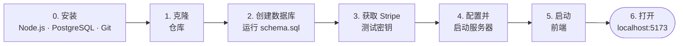

### 第 0 步：安装所需软件

| 工具 | 版本 | 说明 |
|---|---|---|
| **Node.js** | **20.19 或更新版本**（推荐 22 LTS） | 已包含 `npm`。可用 `node -v` 查看版本 |
| **PostgreSQL** | 任何较新的版本（开发时使用 15） | 请记住安装时设置的用户名和密码 |
| **Git** | 任何版本 | 用于克隆仓库 |
| **Stripe 账户** | 免费 | **必需**：没有 Stripe 密钥时服务器无法启动。测试模式即可，不涉及真实金钱 |
| Stripe CLI | 可选 | 仅在本地确认付款时需要（见[使用 Stripe 付款](#使用-stripe-付款)） |
| SendGrid 账户 | 可选 | 仅在发送注册与重设密码邮件时需要 |

### 第 1 步：克隆仓库

```bash
git clone https://github.com/jlau050426/shopeasy-pern-ecommerce.git
cd shopeasy-pern-ecommerce/shopping-app
```

以下所有命令都从这个 `shopping-app` 文件夹开始执行。

### 第 2 步：创建数据库

创建一个空数据库（这里命名为 `shopping_app`）：

```bash
psql -U postgres -c "CREATE DATABASE shopping_app;"
```

创建数据表和配送方式：

```bash
psql -U postgres -d shopping_app -f server/schema.sql
```

你应该会看到 6 次 `CREATE TABLE` 和一次 `INSERT 0 3`。如果你的 PostgreSQL 用户名不同，请将 `postgres` 替换掉。用于登录的 `session` 表会在服务器启动时自动创建。

> **Windows：** `psql` 通常不在系统 PATH 中。请使用完整路径，例如
> `"C:\Program Files\PostgreSQL\15\bin\psql.exe" -U postgres -c "CREATE DATABASE shopping_app;"`，
> 或使用 **pgAdmin**：创建数据库后，在 **Query Tool** 中打开 `server/schema.sql` 并运行。

### 第 3 步：获取 Stripe 测试密钥

登录 [dashboard.stripe.com](https://dashboard.stripe.com)，确认已开启 **Test mode（测试模式）**，然后前往 **Developers → API keys**，复制 **Secret key**（以 `sk_test_` 开头）。

### 第 4 步：配置并启动服务器

根据模板创建服务器的 `.env` 文件（Windows 命令提示符请使用 `copy .env.example .env`）：

```bash
cd server
cp .env.example .env
```

打开 `server/.env` 并填入你的设置：

| 设置 | 填写内容 |
|---|---|
| `DATABASE_USER`、`DATABASE_PASSWORD` | 你的 PostgreSQL 用户名和密码 |
| `DATABASE_NAME` | `shopping_app`（或你在第 2 步使用的名称） |
| `SESSION_SECRET` | 任意一段较长的随机文字（见下方命令） |
| `ADMIN_PASSKEY` | 你自定的代码。在注册页面输入它即可创建管理员 |
| `STRIPE_SECRET_KEY` | 第 3 步获得的 `sk_test_...` 密钥 |
| `STRIPE_WEBHOOK_SECRET` | 暂时保持不变（见[使用 Stripe 付款](#使用-stripe-付款)） |
| `SENDGRID_API_KEY`、`EMAIL_FROM` | 可选，用于发送邮件 |

生成随机的 `SESSION_SECRET`：

```bash
node -e "console.log(require('crypto').randomBytes(32).toString('hex'))"
```

除非需要其他端口，否则请保留 `PORT=3000` 和 `FRONTEND_URL=http://localhost:5173`。如果你修改了 `PORT`，也请同步修改 `frontend/.env` 中的 `VITE_API_URL`。

安装依赖并启动服务器：

```bash
npm install
npm run dev
```

你应该会看到 `Server listen on PORT 3000`。请保持这个终端开启。

### 第 5 步：启动前端

在 `shopping-app` 文件夹中打开**第二个终端**：

```bash
cd frontend
npm install
npm run dev
```

前端已包含 `frontend/.env`，其中的 `VITE_API_URL=http://localhost:3000` 会让它自动找到服务器。

### 第 6 步：打开商店

前往 **http://localhost:5173**。一切运行后，整体情况如下：

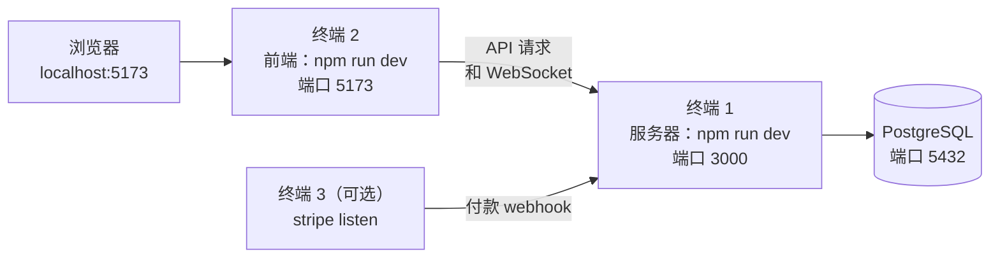

商店一开始是空的。请继续阅读下一节来新增商品。

---

## 首次使用

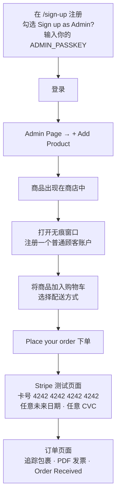

| 字段 | 规则 |
|---|---|
| 密码 | 至少 6 个字符，只能包含字母和数字 |
| 商品标题 | 至少 3 个字符 |
| 商品图片 | PNG 或 JPG，最大 5 MB |
| 商品价格 | RM 1 至 RM 99,999 |
| 商品描述 | 至少 6 个字符 |

---

## 使用 Stripe 付款

付款完成后，Stripe 会通过 **webhook** 通知你的服务器。在你自己的电脑上，Stripe 无法直接访问 `localhost`，因此需要由 **Stripe CLI** 帮你转发事件：

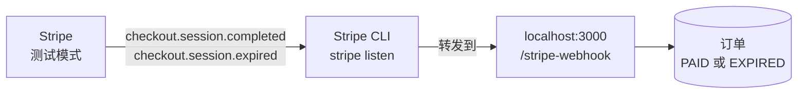

1. 安装 Stripe CLI：[stripe.com/docs/stripe-cli](https://stripe.com/docs/stripe-cli)
2. 登录一次：

   ```bash
   stripe login
   ```

3. 将 webhook 事件转发到你的服务器（请在第三个终端中保持运行）：

   ```bash
   stripe listen --forward-to localhost:3000/stripe-webhook
   ```

4. 它会显示一个以 `whsec_` 开头的签名密钥。将它填入 `server/.env` 的 `STRIPE_WEBHOOK_SECRET`，然后重启服务器。

**没有 Stripe CLI 时**，付款仍然可以完成，但付款后订单会一直显示为 **Pending Payment（待付款）**。在订单页面点击 **CONTINUE PAYMENT（继续付款）**，服务器就会直接向 Stripe 查询，并将订单标记为已付款。

| 测试卡号 | 结果 |
|---|---|
| `4242 4242 4242 4242` | 付款成功 |
| `4000 0000 0000 9995` | 付款被拒绝（余额不足） |

---

## 环境变量

### 服务器：`shopping-app/server/.env`

| 变量 | 是否必需 | 示例 | 说明 |
|---|---|---|---|
| `PORT` | 否（默认 `5000`） | `3000` | API 服务器端口，必须与前端的 `VITE_API_URL` 一致 |
| `FRONTEND_URL` | **是** | `http://localhost:5173` | React 应用的地址，用于 CORS、Socket.IO、Stripe 跳转和邮件链接 |
| `DATABASE_HOST` | **是** | `localhost` | PostgreSQL 主机 |
| `DATABASE_PORT` | **是** | `5432` | PostgreSQL 端口 |
| `DATABASE_USER` | **是** | `postgres` | PostgreSQL 用户名 |
| `DATABASE_PASSWORD` | **是** | | PostgreSQL 密码 |
| `DATABASE_NAME` | **是** | `shopping_app` | 第 2 步创建的数据库 |
| `SESSION_SECRET` | **是** | 随机文字 | 用于签署会话 Cookie。没有它，所有请求都会失败 |
| `ADMIN_PASSKEY` | **是**（管理员需要） | | 注册管理员时需要输入的代码 |
| `STRIPE_SECRET_KEY` | **是** | `sk_test_...` | Stripe 密钥。没有它，服务器无法启动 |
| `STRIPE_WEBHOOK_SECRET` | webhook 需要 | `whsec_...` | 来自 `stripe listen` 或 Stripe 控制台 |
| `SENDGRID_API_KEY` | 邮件需要 | `SG....` | SendGrid API 密钥 |
| `EMAIL_FROM` | 邮件需要 | `you@example.com` | 发件人地址，必须是你的 SendGrid 账户中已验证的发件人 |

### 前端：`shopping-app/frontend/.env`

| 变量 | 默认值 | 说明 |
|---|---|---|
| `VITE_API_URL` | `http://localhost:3000` | API 服务器地址，用于请求、Socket.IO 和图片 |

> 切勿提交 `server/.env`：它包含你真实的密钥。它已列在 `.gitignore` 中。

---

## 可用脚本

| 文件夹 | 命令 | 说明 |
|---|---|---|
| `server` | `npm run dev` | 使用 nodemon 启动服务器（文件更改时自动重启） |
| `server` | `npm start` | 使用 Node 启动服务器（不会自动重启） |
| `frontend` | `npm run dev` | 在端口 5173 启动 Vite 开发服务器 |
| `frontend` | `npm run build` | 将生产版本构建到 `dist/` |
| `frontend` | `npm run preview` | 在本地预览生产版本 |
| `frontend` | `npm run lint` | 使用 ESLint 检查代码 |

---

## API 参考

所有端点都相对于 `http://localhost:3000`。修改数据的请求（`POST`、`PUT`、`DELETE`）需要附带 `X-CSRF-Token` 标头（见[会话与 CSRF 防护](#会话与-csrf-防护)）。🔒 = 必须登录，👑 = 必须是管理员。

### 商品与购物车

| 方法 | 端点 | 说明 |
|---|---|---|
| `GET` | `/?page=1` | 某一页的商品（每页 50 件） |
| `GET` | `/product/:productID` | 单件商品 |
| `GET` | `/delivery-options` | 三种配送方式 |
| `GET` | `/cart` 🔒 | 用户的购物车、商品总额和运费总额 |
| `POST` | `/cart` 🔒 | 加入商品：`{ productId, quantity }`（数量 1 至 10） |
| `PUT` | `/cart-items/:id` 🔒 | 更改购物车项目的配送方式：`{ deliveryOptionId }` |
| `DELETE` | `/cart-delete-item/:id` 🔒 | 移除购物车项目 |

### 结账与订单

| 方法 | 端点 | 说明 |
|---|---|---|
| `POST` | `/checkout` 🔒 | 创建待付款订单和 Stripe 结账会话；返回 `checkoutUrl` |
| `POST` | `/checkout/continue` 🔒 | 继续待付款的付款（若 Stripe 已完成付款，则直接标记为已付款） |
| `GET` | `/pending-payment` 🔒 | 有待付款时返回 `200`，没有时返回 `204` |
| `GET` | `/checkout/orders` 🔒 | 用户的订单，并按订单分组列出项目 |
| `GET` | `/checkout/order-&-product?orderID=&productID=` 🔒 | 某订单中的单个项目（用于追踪） |
| `GET` | `/order/:orderID` 🔒 | 下载 PDF 发票（仅限已付款订单） |
| `DELETE` | `/orders/:orderId` 🔒 | 将已付款订单标记为已收货（会移除订单） |
| `DELETE` | `/remove-payment/:orderId` 🔒 | 取消待付款的付款 |
| `DELETE` | `/remove-expired/:orderId` 🔒 | 移除已过期的订单 |
| `POST` | `/stripe-webhook` | Stripe webhook（原始请求内容，通过签名验证） |

### 身份验证

| 方法 | 端点 | 说明 |
|---|---|---|
| `GET` | `/csrf-token` | 获取当前会话的 CSRF 令牌 |
| `POST` | `/sign-up` | `{ email, password, confirmPassword, adminInvitationCode? }` |
| `POST` | `/login` | `{ email, password }`；开始新的会话 |
| `POST` | `/logout` | 结束会话 |
| `POST` | `/reset` | `{ email }`；发送重设密码链接 |
| `POST` | `/new-password` | `{ token, newPassword, confirmPassword }` |
| `GET` | `/check-admin` | 管理员返回 `200`，普通用户返回 `403`，访客返回 `401` |

### 管理员（前缀 `/admin`）

| 方法 | 端点 | 说明 |
|---|---|---|
| `GET` | `/admin/admin-page` 👑 | 检查商品列表页的管理员权限 |
| `GET` | `/admin/add-product` 👑 | 检查新增表单的管理员权限 |
| `POST` | `/admin/add-product` 👑 | 新增商品（`multipart/form-data`：`title`、`price`、`description`、`image`） |
| `GET` | `/admin/edit-product/:productID` 👑 | 获取商品当前的资料，用于编辑表单 |
| `POST` | `/admin/edit-product` 👑 | 更新商品（`id`、`title`、`price`、`description`，`image` 可选） |
| `DELETE` | `/admin/delete-product/:productID` 👑 | 删除商品（若曾出现在任何订单中则拒绝） |

### Socket.IO 事件（服务器 → 浏览器）

| 事件 | 发送对象 | 触发时机 |
|---|---|---|
| `cart:updated` | 该用户的所有标签页 | 商品被加入购物车（或被管理员移除） |
| `cart:deleted` | 该用户的所有标签页 | 购物车项目被移除 |
| `cart:delivery-updated` | 该用户的所有标签页 | 配送方式被更改 |
| `auth:logout` | 该用户的所有标签页 | 用户已登出 |
| `admin-product-added` / `-edited` / `-removed` | 所有人 | 管理员更改了商品目录 |

---

## 数据库结构

数据表由 `server/schema.sql` 创建。`session` 表由 `connect-pg-simple` 自动创建。

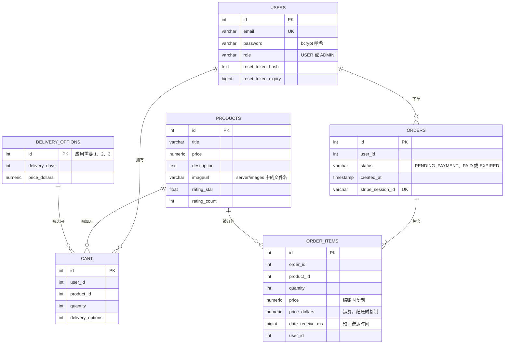

- 表之间的关系由应用程序代码维护（数据表没有外键）。
- `cart` 中每个用户的每件商品只有一行（`UNIQUE (user_id, product_id)`）；再次加入同一商品会增加数量。
- 价格和运费会在结账时复制到 `order_items`，因此之后修改商品不会影响过去的订单。

---

## 已知限制

- **总额可能相差 RM 0.01。** 购物车页面、订单页面和 Stripe 对 10% 税费的四舍五入方式略有不同，因此总额偶尔会相差 1 仙。实际扣款金额以 Stripe 付款页面显示的金额为准。购物车页面上有相关提示。
- **图片保存在服务器磁盘上**（`server/images`），不在 git 或数据库中。新复制的项目一开始没有商品图片，而且有些托管服务会在每次部署时删除本地文件。
- **评分星星**仅用于显示。目前还无法为商品评分，因此通过管理员表单新增的商品会显示空星。
- 目前还**没有自动化测试**。
- 本项目为**本地开发**而构建和测试。部署到生产环境需要额外设置（仅限 HTTPS 的 Cookie、代理设置、生产环境 URL 以及 Stripe webhook 端点）。
